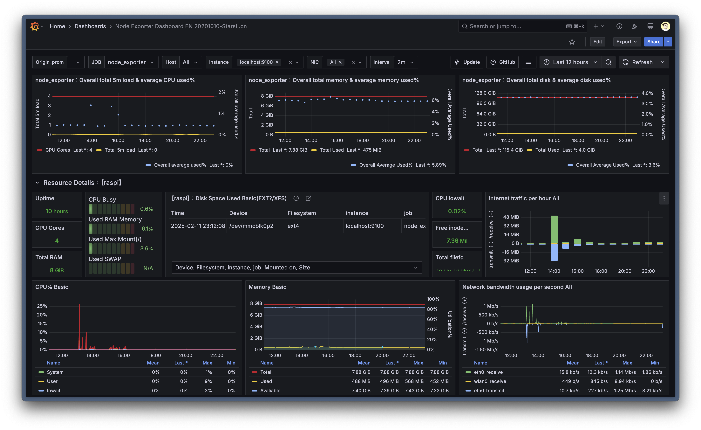
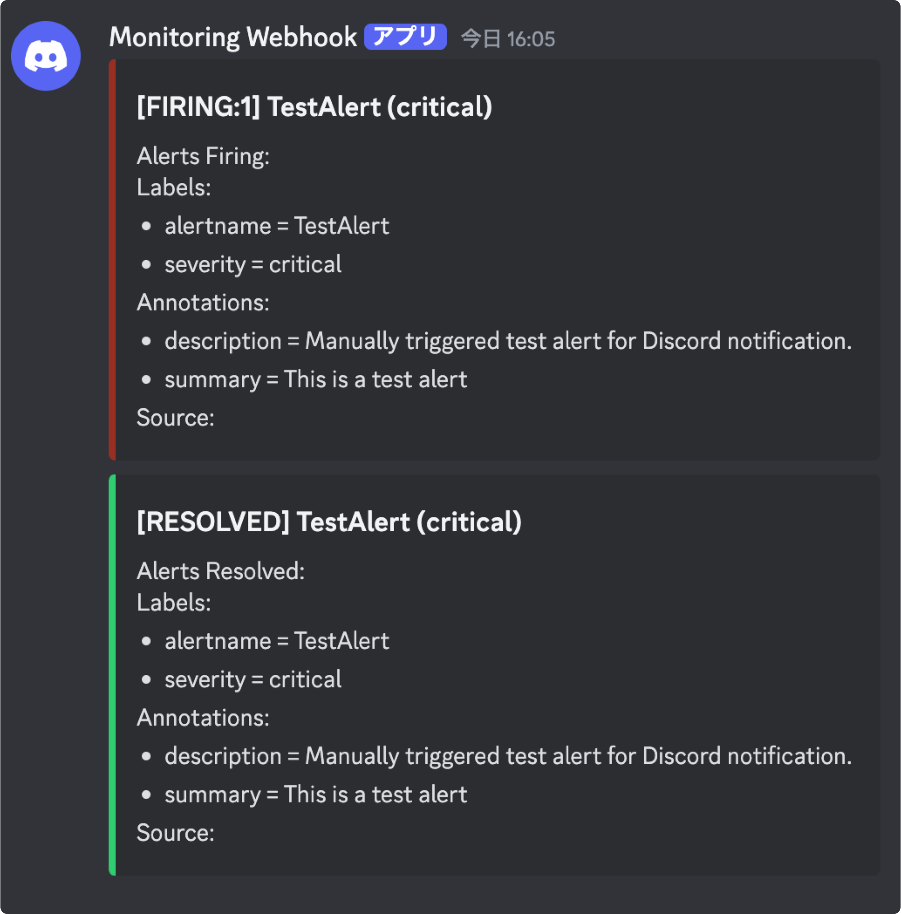
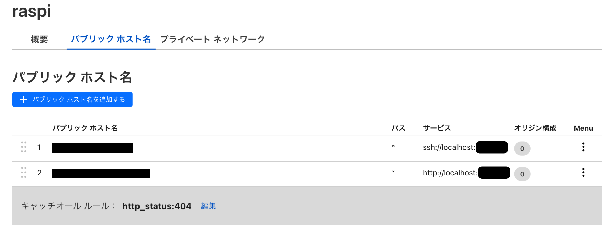

## はじめに

最近、Raspberry Pi 5 を購入して初期構築を Ansible で行ったので、その内容を共有します。


## セットアップする内容

- OS, パッケージのアップデート
- 基本的なセキュリティ設定
  - SSHの設定
  - ファイアウォールの設定
- docker のインストール
- Prometheus のセットアップ
- Grafana のセットアップ
- Cloudflare Tunnel の設定
  - 外部ネットワークからSSH接続できるようにする


## 事前準備

以下の状態にします。手順が不明な場合は他のネット資料をご参照ください。

- [Raspberry Pi OS Lite 64-bit](https://www.raspberrypi.com/software/operating-systems/) をインストール
  - [Raspberry Pi Imager](https://www.raspberrypi.com/software/) を使って以下を設定
    - デフォルトユーザー `pi` ではないユーザー名を設定
    - SSH を有効化 (推奨: 公開鍵認証)
    - ホスト名を設定 (今回は raspi.local)
    - 他はお好みで
  - 今回はサーバー運用がメインなので Raspberry Pi OS Lite を選択
- `ssh raspi.local` で SSH 接続できることを確認
- Cloudflare Tunnel の設定を行っておりリフレッシュトークンを取得している


### Cloudflare Tunnel の注意点

この記事では Cloudflare Tunnel を使って外部ネットワークから SSH 接続できるように環境構築していますが、参考にされる場合は Cloudflare の設定は慎重に行ってください。
Cloudflare Access などを使った保護などは必ず入れましょう。


## OS, パッケージのアップデート

以下のコマンドと同等の処理を Ansible で行います。また、必要なら再起動を挟みます。

```bash
sudo apt update && sudo apt upgrade -y && sudo apt full-upgrade -y && sudo apt autoremove -y && sudo apt autoclean -y
```

```yaml:roles/system/tasks/main.yml
---
- name: Update and upgrade system
  block:
    - name: Update apt cache
      apt:
        update_cache: yes
        cache_valid_time: 3600
      become: true
      tags: ["update"]

    - name: Perform full system upgrade
      apt:
        upgrade: full
      become: true
      register: upgrade_result
      tags: ["update"]

    - name: System cleanup
      apt:
        autoremove: "{{ item.autoremove | default(omit) }}"
        autoclean: "{{ item.autoclean | default(omit) }}"
      become: true
      loop:
        - { autoremove: true }
        - { autoclean: true }
      tags: ["cleanup"]
  rescue:
    - name: Log update failure
      debug:
        msg: "System update failed: {{ ansible_failed_task }}"

  always:
    - name: Check if reboot is required
      stat:
        path: /var/run/reboot-required
      register: reboot_required

    - name: Reboot system if required
      reboot:
        msg: "Reboot required after system update"
      when: reboot_required.stat.exists
      tags: ["never", "reboot"]
```


## 基本的なセキュリティ設定

- Linux ユーザーの設定 (今回の Raspberry Pi Imager 経由でのセットアップでは不要そうですが念のため)
  - 既存ユーザーの設定 (作成、sudo 設定など)
  - デフォルトユーザー pi の削除
- SSH の設定 (ポート変更、root ログイン禁止、パスワードログイン禁止)
- devsec.hardening.ssh_hardening を適用して SSH の設定を強化
- ファイアウォールの設定 (SSH ポートを許可。今回はグローバルに公開する必要がないため過剰)
- fail2ban はインストールだけしてまだ設定していない

```yaml:roles/security/tasks/main.yml
---
- name: Check if admin user exists
  getent:
    database: passwd
    key: "{{ admin_user }}"
  register: admin_user_exists
  tags: ["users"]

- name: Ensure admin user exists
  user:
    name: "{{ admin_user }}"
    state: present
    groups: "{{ admin_groups }}"
    append: true
    shell: /bin/bash
    create_home: true
  become: true
  when:
    - create_admin_user | bool
    - not admin_user_exists.ansible_facts.getent_passwd[admin_user] is defined
  tags: ["users"]

- name: Update admin user groups
  user:
    name: "{{ admin_user }}"
    groups: "{{ admin_groups }}"
    append: true
  become: true
  when:
    - create_admin_user | bool
    - admin_user_exists.ansible_facts.getent_passwd[admin_user] is defined
  tags: ["users"]

- name: Set up sudo for admin user
  copy:
    dest: "/etc/sudoers.d/{{ admin_user }}"
    content: "{{ admin_user }} ALL=(ALL) NOPASSWD: ALL\n"
    mode: "0440"
    validate: "visudo -cf %s"
  become: true
  when: create_admin_user | bool
  tags: ["users"]

- name: Remove default pi user
  user:
    name: pi
    state: absent
    remove: true
    force: true
  become: true
  when:
    - remove_default_user | bool
    - ansible_user != default_user
  tags: ["users"]

- name: Enhance SSH security
  ansible.builtin.include_role:
    name: devsec.hardening.ssh_hardening
  vars:
    ssh_client_port: "{{ ssh_port | int }}"
    ssh_permit_root_login: "no"
    ssh_client_password_login: "no"
    ssh_allow_tcp_forwarding: true
  tags: ["security", "ssh"]

- name: Install basic security packages
  become: true
  ansible.builtin.apt:
    name:
      - ufw
      - fail2ban
    state: present
  tags: ["security"]

- name: Allow SSH ports in UFW
  become: true
  community.general.ufw:
    rule: allow
    port: "{{ item }}"
    proto: tcp
  loop:
    - "{{ ssh_port }}"
  tags: ["security", "ssh"]

- name: Set UFW default policy
  become: true
  community.general.ufw:
    state: enabled
    default: deny
    direction: incoming
  tags: ["security"]
```


## docker のインストール

docker のインストールは geerlingguy.docker を使います。一緒に docker compose プラグインもセットアップ。

```yaml:playbook.yml
    - role: geerlingguy.docker
      become: true
      vars:
        docker_edition: "ce" # Community Edition
        docker_install_compose_plugin: true
```

この処理には geerlingguy.docker の事前インストールが必要です。以下のようなファイルを用意しておき、適用前に `ansible-galaxy install -r requirements.yml` を実行します。
(このファイルはセキュリティ設定のロールで必要な devsec.hardening もインストールしています)

```yaml:requirements.yml
---
collections:
  # Ref: https://galaxy.ansible.com/ui/repo/published/devsec/hardening/
  - name: devsec.hardening
    version: 10.2.0
roles:
  # Ref: https://galaxy.ansible.com/ui/standalone/roles/geerlingguy/docker/
  - name: geerlingguy.docker
    version: 7.4.5
```


## Prometheus / Grafana のセットアップ

Raspberry Pi のメトリクスを収集・可視化・アラート通知するために、Prometheus とそのプラグイン、Grafana をセットアップします。

アップデートを簡単にしたかったので、コンテナにて管理しています。

```yaml:roles/monitoring/tasks/main.yml
- name: Create /opt/monitoring directory
  become: true
  file:
    path: /opt/monitoring
    state: directory
    mode: "0755"

- name: Deploy docker-compose file for Prometheus stack
  become: true
  template:
    src: docker-compose.prometheus.yml.j2
    dest: /opt/monitoring/docker-compose.yml
    mode: "0644"

- name: Deploy Prometheus config file
  become: true
  template:
    src: prometheus.yml.j2
    dest: /opt/monitoring/prometheus.yml
    mode: "0644"

- name: Deploy Alertmanager config file
  become: true
  template:
    src: alertmanager.yml.j2
    dest: /opt/monitoring/alertmanager.yml
    mode: "0644"

- name: Start Prometheus stack with docker compose
  become: true
  command: docker compose -f /opt/monitoring/docker-compose.yml up -d
  args:
    chdir: /opt/monitoring
```

Prometheus 他を起動するための docker-compose.yml です。restart: always にしているので、再起動時に自動で起動します。

```yaml:roles/monitoring/templates/docker-compose.prometheus.yml.j2
services:
  prometheus:
    image: prom/prometheus:latest
    platform: linux/arm64
    network_mode: host
    volumes:
      - /opt/monitoring/prometheus.yml:/etc/prometheus/prometheus.yml:ro
      - prometheus_data:/prometheus
    restart: always

  node_exporter:
    image: prom/node-exporter:latest
    platform: linux/arm64
    network_mode: host
    volumes:
      - /proc:/host/proc:ro
      - /sys:/host/sys:ro
      - /:/rootfs:ro
    command:
      - --path.procfs=/host/proc
      - --path.sysfs=/host/sys
      - --collector.filesystem.ignored-mount-points="^/(sys|proc|dev|host|etc)($|/)"
    restart: always

  alertmanager:
    image: prom/alertmanager:latest
    platform: linux/arm64
    volumes:
      - /opt/monitoring/alertmanager.yml:/etc/alertmanager/alertmanager.yml:ro
    ports:
      - "9093:9093"
    restart: always

  grafana:
    image: grafana/grafana:latest
    platform: linux/arm64
    volumes:
      - grafana_data:/var/lib/grafana
    ports:
      - "9999:3000"
    extra_hosts:
      - "host.docker.internal:host-gateway"
    restart: always

volumes:
  prometheus_data:
  grafana_data:
```

Prometheus と alertmanager の設定ファイルは特段変わったことはしていませんが、Prometheus 本体 (と node_exporter) は `network_mode: host` を設定しているため、この設定ファイルはコンテナホストのネットワークが基準になります。
可能なら `network_mode: host` は避けたいので、今後の改善ポイントです。

```yaml:roles/monitoring/templates/prometheus.yml.j2
global:
  scrape_interval: 15s

scrape_configs:
  - job_name: "prometheus"
    static_configs:
      - targets: ["localhost:9090"]

  - job_name: "node_exporter"
    static_configs:
      - targets: ["localhost:9100"]

alerting:
  alertmanagers:
    - static_configs:
        - targets: ['alertmanager:9093']
```

アラート通知は Discord に通知します。ネット記事には discord_configs ではなく別プロセスを立ち上げた上での webhook_configs の記載が多いですが、それらは不要で単純に discord_configs で動作します ((おそらく) 動作するようになりました)。

```yaml:roles/monitoring/templates/alertmanager.yml.j2
global:
  resolve_timeout: 5m

route:
  group_by: ['alertname']
  group_wait: 30s
  group_interval: 5m
  receiver: discord

receivers:
  - name: discord
    discord_configs:
      - webhook_url: {{ lookup("env", "DISCORD_MONITORING_WEBHOOK_URL") }}
```

http://raspi.local:9999 にアクセスすると Grafana にアクセスできます。(LAN からアクセスするなら ufw で許可することをお忘れなく。Grafana のダッシュボードは適宜インポートしました)
デフォルトのアカウント認証は username: admin / password: admin で入れるので、すぐに username と password を変更しましょう。



アラート時には以下のような例で通知されます




## Cloudflare Tunnel の設定

最新版の `cloudflared` をインストールして Tunnel を設定します。
設定を簡略化するために refresh_token を使って設定しているため、事前に Cloudflare Tunnel の設定が必要です。

```yaml:roles/cloudflared/tasks/main.yml
---
- name: Get latest Cloudflared version
  ansible.builtin.uri:
    url: https://api.github.com/repos/cloudflare/cloudflared/releases/latest
    return_content: true
  register: latest_release
  tags: ["cloudflared"]

- name: Get current Cloudflared version
  ansible.builtin.command:
    cmd: cloudflared --version
  register: current_version
  failed_when: false
  changed_when: false
  tags: ["cloudflared"]

- name: Install or Update Cloudflared
  become: true
  ansible.builtin.apt:
    deb: "{{ cloudflared_deb_url }}"
  when: >
    current_version.rc != 0 or
    latest_release.json.tag_name not in current_version.stdout
  tags: ["cloudflared"]

- name: Check if Cloudflared service exists
  ansible.builtin.stat:
    path: /etc/systemd/system/cloudflared.service
  register: cloudflared_service
  tags: ["cloudflared"]

- name: Install the Cloudflared tunnel as a systemd service
  become: true
  ansible.builtin.command:
    cmd: "cloudflared service install {{ cloudflared_token }}"
    creates: /etc/systemd/system/cloudflared.service
  when: not cloudflared_service.stat.exists
  tags: ["cloudflared"]

- name: Ensure Cloudflared service is enabled and started
  become: true
  ansible.builtin.systemd:
    name: cloudflared
    state: started
    enabled: true
  tags: ["cloudflared"]
```

```yaml:roles/cloudflared/defaults/main.yml
---
cloudflared_arch: arm64
cloudflared_deb_url: "https://github.com/cloudflare/cloudflared/releases/latest/download/cloudflared-linux-{{ cloudflared_arch }}.deb"
cloudflared_token: "{{ lookup('env', 'CLOUDFLARED_TOKEN') }}"
```

この構成を適用した上で Cloudflare Tunnel にパブリックホスト名を設定した場合、外部ネットワークにそのポートを公開することになります。重ねてになりますが、公開を意図していない場合は Cloudflare Access などを使った保護を必ず入れましょう。
(個人的な展望では、いずれここら辺も Terraform で管理したい)

Cloudflare Tunnel を以下のように設定すると、外部ネットワークから SSH / Grafana にアクセスできるようになります。



詳しい手順は、以下か他のネット資料をご参照ください。

- 公式 Tunnel: [Create a remotely-managed tunnel (dashboard) · Cloudflare Zero Trust docs](https://developers.cloudflare.com/cloudflare-one/connections/connect-networks/get-started/create-remote-tunnel/)
- 公式 Access: [Publish a self-hosted application to the Internet · Cloudflare Zero Trust docs](https://developers.cloudflare.com/cloudflare-one/applications/configure-apps/self-hosted-public-app/)
- [Cloudflare Zero TrustとRaspberry Piを使って自宅のPCをクラウド化する](https://zenn.dev/so298/articles/cloudflare-raspberrypi)

~/.ssh/config に以下を追加すると、`ssh raspi.remote` で 自宅の `raspi` に接続できるようになります (認証を挟みます)。

```
Host raspi.remote
  HostName example.com
  User hogefuga
  Port 50988 # 設定した SSH ポート
  IdentityFile ~/.ssh/id_rsa # Raspberry Pi Imager で設定・作成した秘密鍵
  ProxyCommand cloudflared access ssh --hostname %h
```


## 参考情報

### ディレクトリ構成

色々割愛しましたが、Ansible の変数は host_vars で、秘匿情報は .env で管理しました。しかし、host_vars の中身をコミットしないのであれば .env は不要かというのが正直なところです。

当記事に全てのファイルを記載するわけにはいかないため、必要に応じて適宜調整してください🙏

```bash
$ tree
.
├── Makefile
├── README.md
├── ansible.cfg
├── host_vars
│   ├── raspi.yml
│   └── raspi.yml.example
├── inventory.yml
├── playbook.yml
├── requirements.yml
└── roles
    ├── cloudflared
    │   ├── defaults
    │   │   └── main.yml
    │   └── tasks
    │       └── main.yml
    ├── monitoring
    │   ├── tasks
    │   │   └── main.yml
    │   └── templates
    │       ├── alertmanager.yml.j2
    │       ├── docker-compose.prometheus.yml.j2
    │       └── prometheus.yml.j2
    ├── security
    │   ├── defaults
    │   │   └── main.yml
    │   └── tasks
    │       └── main.yml
    └── system
        └── tasks
            └── main.yml

14 directories, 17 files
```

なお、この構成では ansible-playbook を実行する前に .env を読み込む必要があるため、Makefile を作成して `make apply` で実行しています。

```Makefile:Makefile
include .env
export

.PHONY: apply check init

PLAYBOOK ?= playbook.yml
ANSIBLE_ARGS ?=

apply:
	ansible-playbook $(PLAYBOOK) $(ANSIBLE_ARGS);

init:
	@if [ ! -f host_vars/raspi.yml ]; then \
		cp host_vars/raspi.yml.example host_vars/raspi.yml; \
		echo "Created host_vars/raspi.yml from example"; \
		echo "Please edit host_vars/raspi.yml with your settings"; \
	fi
	@if [ ! -f .env ]; then \
		cp .env.sample .env; \
		echo "Created .env from sample"; \
		echo "Please edit .env with your token"; \
	fi
	@ansible-galaxy install -r requirements.yml
```

### Ansible でセットアップする理由

以下の理由を考えながらやっていました。

- Raspberry Pi のセットアップを自動化して、気軽に初期化できるようにする
- Ansible 経由の変更に限定することで、Raspberry Pi の現在の設定を明示的に管理する (べき等性による)
- サーバーを立てる際にセットアップ内容を調べ直しているのでいい加減まとめたい

s
### 今回購入したリスト

今回の構成で使用したリストです。サーバー運用だけであれば上三つさえあれば構築できます。参考までに。

- [Raspberry Pi 5 8G](https://amzn.asia/d/9quzpnt)
- [電源: Geekworm USB-C 電源アダプター PD 27W Type C](https://amzn.asia/d/1juo44J)
- [Amazonベーシック microSDXCメモリーカード 128GB](https://amzn.asia/d/0WUKNSA)
- お好みで
  - [Raspberry Pi 5 Active Cooler](https://amzn.asia/d/1juo44J)
  - [Amazonベーシック マイクロHDMI-HDMIケーブル](https://amzn.asia/d/ewfYEFH) (サーバー運用のみであれば不要)

※ Amazon はサクラと思われるコメントが非常に多いらしい (ソースは[サクラチェッカー](https://sakura-checker.jp/)) ため、どうしても最安値を狙わないといけない場合を除いて、[スイッチサイエンス](https://www.switch-science.com/) や [Raspberry Pi Shop by KSY](https://raspberry-pi.ksyic.com/main/index) などの名の知れたショップを利用したほうが良さそうです。


## まとめ

以上で外部ネットワークから 自宅の `raspi` にSSHしつつ、Prometheus / Grafana によってサーバーのモニタリング・異常通知を行えるようになりました。

再三になりますが、Cloudflare Tunnel を使って SSH 接続を設定した場合は、必ず Cloudflare Access などを使った保護を必ず入れましょう。
